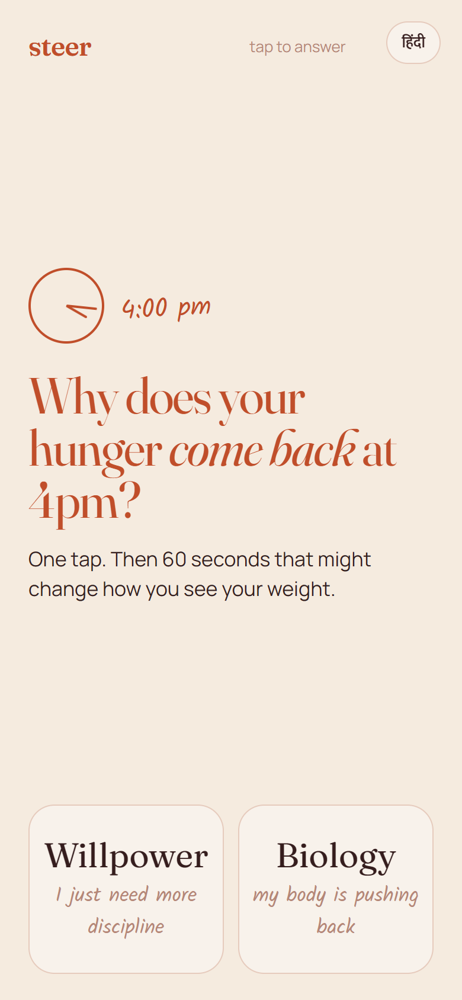
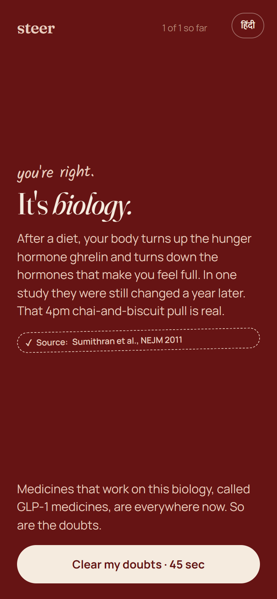
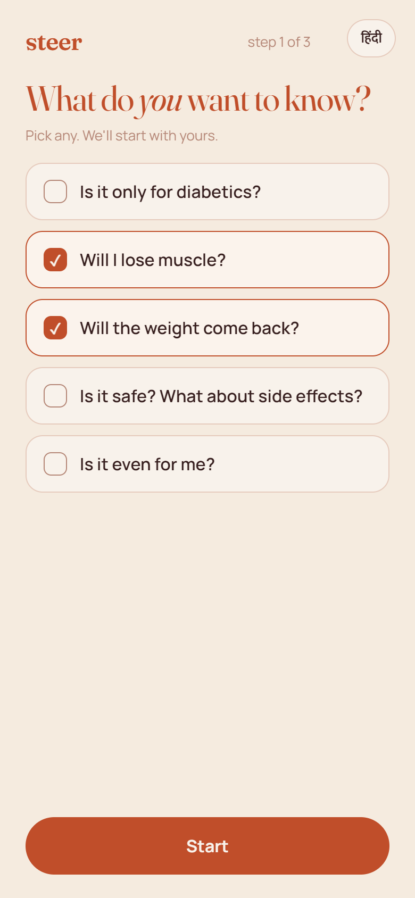
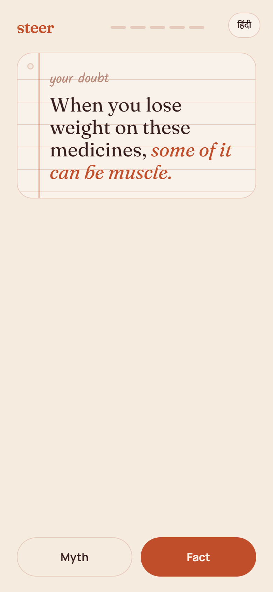
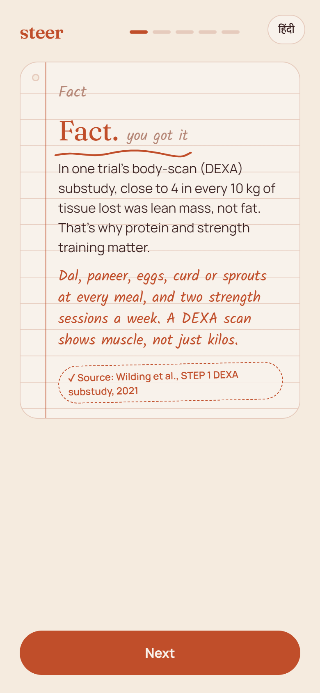
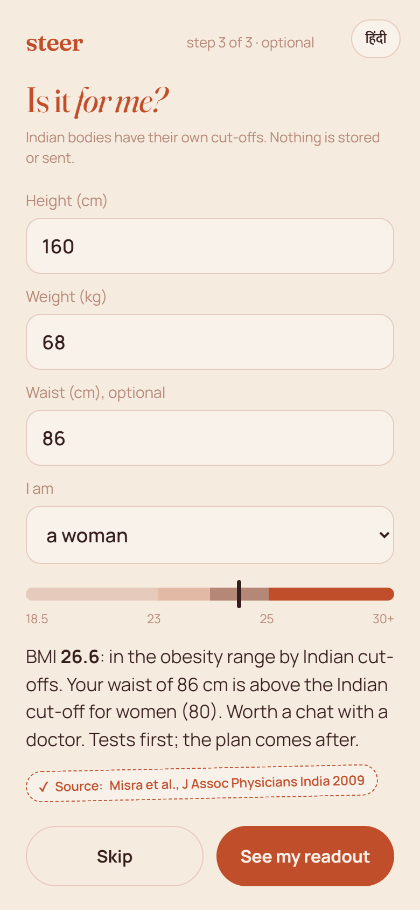
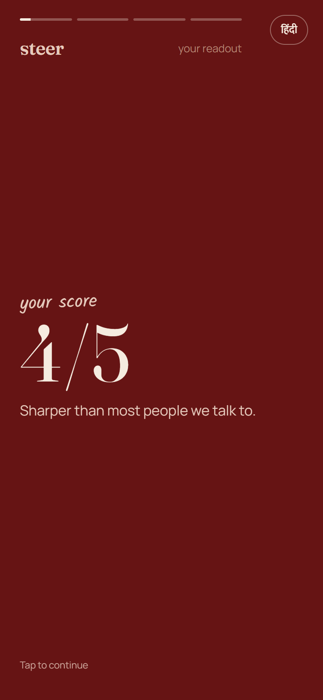
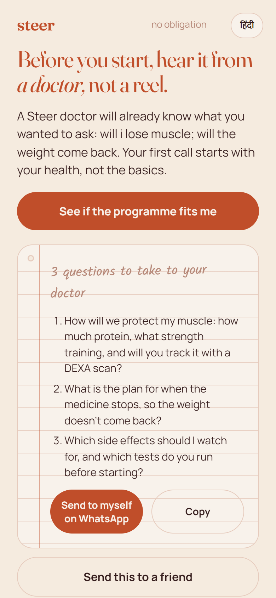
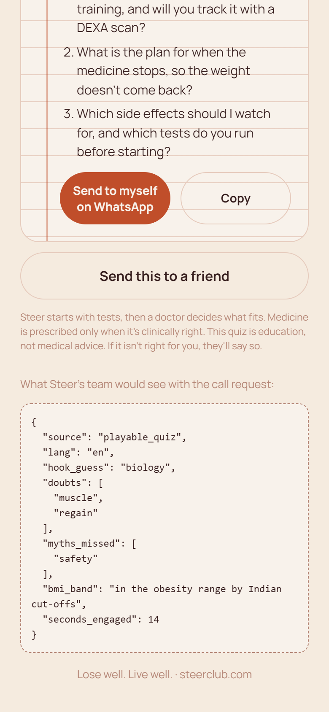
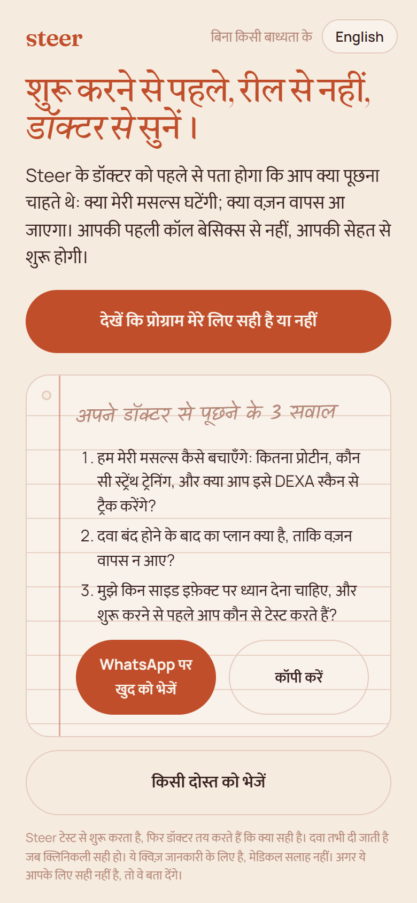

# Willpower or biology?

A 60-second playable quiz for Instagram and Facebook, built for the Steer Club Hackathon (Problem Statement 1: "The ad people want to tap").

**Play it:** https://steer-willpower-or-biology-1037019152152.asia-south1.run.app
**What Steer's team would receive with the call request:** add `?team=1` to the link. **Hindi:** tap हिंदी in the corner, or add `?lang=hi`.

## At a glance

- **Target device / browser:** phones first (designed at 390 px wide; tested in mobile Chrome/Edge emulation at 390x844 and on a desktop browser, where it shows in a phone frame). Works in any modern browser: Chrome, Safari, Edge, Firefox, Samsung Internet, and Instagram/Facebook in-app browsers. No login, no install, no build step.
- **Completion status:** complete and live. All 7 screens work end to end in English and Hindi; every claim has a tappable source; nothing the person types is stored or sent. Not done (optional per the rules): uploading it as a real Meta playable ad, and wiring the lead to a real CRM (the lead JSON is shown with `?team=1`).
- **Files:** `index.html` is the whole playable (one file, about 50 KB including both languages, under Meta's 2 MB playable limit). `docs/` has the walkthrough screenshots below.

## Walkthrough

| 1. Hook | 2. Reveal | 3. Pick your doubts | 4. Myth or fact? | 5. The answer + source |
|---|---|---|---|---|
|  |  |  |  |  |

| 6. Indian cut-offs | 7. Readout | 8. Handoff | 9. Questions for the doctor | 10. Hindi |
|---|---|---|---|---|
|  |  |  |  |  |

## Trigger, value, next step

- **Trigger (first 3 seconds):** "Why does your hunger come back at 4pm?" One tap: *Willpower* or *Biology*.
- **Value (about 60 seconds):** the five doubts people have about GLP-1 medicines (only for diabetics? muscle loss? will it come back? side effects? is it for me?) cleared as myth-or-fact cards, starting with the ones the person picked, each with an Indian-life line and a source; a BMI and waist check on Indian cut-offs; a short "your readout" story with what matters most for someone like them.
- **Next step:** "See if the programme fits me", where the Steer doctor already knows which doubts the person had, so the first call starts with their health, not the basics. The person also leaves with **3 questions to take to their doctor**, built from their doubts, which they can send to themselves on WhatsApp or copy.

## What makes it different

- **English and Hindi.** Every screen, card, readout and question is in both; the facts and numbers are identical.
- **It looks like a trusted doctor's note**, as Steer's brief asks: answers sit on a ruled notepad with a margin line, the Indian-life line is in handwriting (Kalam, from the Indian Type Foundry, which also writes Devanagari), and every source is a stamp you can tap.
- **Typography:** Fraunces for headlines (an editorial serif with a warm italic), Manrope for body text, Tiro Devanagari Hindi and Mukta for Hindi, all in Steer's palette.

## How it works

One HTML file (about 50 KB with both languages, no login, no build step, no tracking), so it can be uploaded as a Meta playable ad (HTML5, under 2 MB) and used unchanged as an entry point on steerclub.com.

1. Hook: a 4pm question and two big tap targets.
2. Reveal: "It's biology", with the hunger-hormone finding and its source.
3. Doubts: the person picks what they want to know; their picks order the cards and become the warm lead.
4. Five myth-or-fact cards: tap, see the answer, the source and an Indian-life line.
5. Optional "Is it for me?": BMI and waist on Asian Indian cut-offs, computed on the phone, nothing stored or sent. Worded as "worth a chat with a doctor", never a diagnosis or a promise.
6. Readout: Wrapped-style story cards (score, what matters for someone like you, numbers or "it was never just willpower") and a share card ("It's biology, not willpower. I scored 4/5. Can you beat it?") for WhatsApp or any app.
7. Handoff + doctor questions: "See if the programme fits me" opens steerclub.com with UTM tags and the person's doubts, and the page shows what the lead looks like for Steer's team: hook answer, doubts picked, myths missed, BMI band, seconds engaged.

## Every claim and its source

| Claim in the game | Source |
|---|---|
| After diet-induced weight loss, ghrelin and hunger rise and appetite hormones stay changed a year later | Sumithran P et al. Long-term persistence of hormonal adaptations to weight loss. *N Engl J Med* 2011;365:1597-1604. doi:10.1056/NEJMoa1105816 |
| GLP-1 medicines were tested in adults **without** diabetes living with obesity | Wilding JPH et al. (STEP 1). *N Engl J Med* 2021;384:989-1002. doi:10.1056/NEJMoa2032183 |
| In a DEXA substudy, close to 40% of the tissue lost was lean mass | Wilding JPH et al., STEP 1 DEXA substudy, ABCD 2021 (exploratory, 140 participants) |
| One year after stopping medicine and lifestyle support, about two-thirds of the lost weight came back | Wilding JPH et al. Weight regain and cardiometabolic effects after withdrawal. *Diabetes Obes Metab* 2022;24:1553-1564. doi:10.1111/dom.14725 |
| Stomach side effects in about 74 of 100 people vs 48 of 100 on placebo, mostly mild to moderate and short-lived | Wilding JPH et al. (STEP 1), *N Engl J Med* 2021 |
| For Asian Indians, overweight from BMI 23, obesity from 25; abdominal obesity from a waist of 90 cm (men) / 80 cm (women) | Misra A et al. Consensus statement for Asian Indians. *J Assoc Physicians India* 2009;57:163-170 |

No drug or brand is named in the game, there are no before/after images and no weight-loss promises; it ends with "If it isn't right for you, they'll say so."

## Built with

Solo build by Ankith M (Steer Club Hackathon, 17-18 Oct 2026). Plain HTML, CSS and JavaScript; fonts from Google Fonts (Fraunces, Manrope, Kalam, Tiro Devanagari Hindi, Mukta). Claude (Anthropic) was used as an AI coding assistant to write the code and to find and check the sources; every claim was checked against the papers above.
